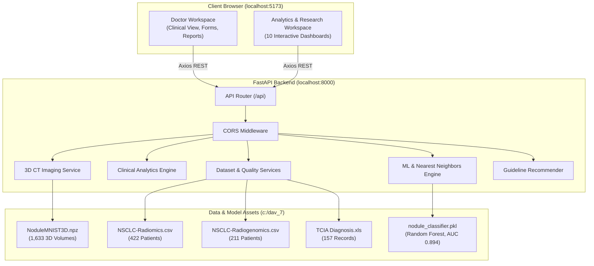

# MediInsight AI: System Architecture Specification

## 1. Architectural Philosophy

MediInsight AI is engineered around strict domain decoupling, clinical safety boundaries, and hardware efficiency. Rather than a monolithic or brittle pipeline, the system utilizes a three-tier decoupled architecture:
1. **Presentation Layer:** React 19 Single Page Application (SPA) driven by Vite and Tailwind CSS.
2. **API & Orchestration Layer:** FastAPI RESTful service exposing non-blocking, typed endpoints.
3. **Data & Analytics Engine:** Scikit-learn, Pandas, SciPy, Lifelines, and NumPy providing high-throughput statistical modeling, volumetric feature extraction, and case retrieval.

---

## 2. Architecture Diagram

---

## 3. Component Breakdown

### 3.1 Backend Service Layer (`backend/app`)
* **`api/`:** Implements route handlers segregated by functional domain (`health.py`, `datasets.py`, `analytics.py`, `imaging.py`, `assessment.py`, `recommendations.py`, `reports.py`).
* **`analytics/`:** Contains domain logic for descriptive statistics, Pearson correlation matrix calculation, Lifelines-based Kaplan-Meier survival curve fitting, and Scikit-learn PCA dimensionality reduction.
* **`imaging/`:** Handles 3D NumPy array indexing, normalization, 3-axis slice extraction (Axial 25%, Center 50%, Axial 75%), and voxel intensity distribution calculations.
* **`models/`:** Encapsulates the Nodule Classifier (Random Forest fitted with 100 decision trees and balanced class weighting), feature extractors, and model serialization.
* **`services/`:** Houses the NearestNeighbors Euclidean search index (k=5 to k=10) for clinical case retrieval and Pandas profiling routines for data quality auditing.

### 3.2 Frontend Application Layer (`frontend/src`)
* **Dual Layout System:**
  * `DoctorLayout` / `DoctorSidebar`: Minimalist, clean clinical aesthetic with clear alert banners and streamlined patient assessment workflows.
  * `AnalyticsLayout` / `AnalyticsSidebar`: Slate-themed, high-density research layout with deep filtering controls, interactive Recharts visualizations, and tabular data viewers.
* **Service Client (`services/api.ts`):** Centralized Axios instance with automatic response handling, base URL configuration, and typed API helper routines.

---

## 4. Hardware Optimization & CPU-First Execution

In compliance with Part 19 of the master prompt:
* **No GPU Requirement:** All algorithms are optimized for standard multi-core x86_64 CPUs.
* **Lightweight Volumetric Radiomics:** Instead of heavy, slow 3D convolutional networks that demand CUDA hardware and gigabytes of VRAM, the system extracts 20 hand-crafted statistical features (voxel gradients, spatial core density, axial distribution) and trains a Scikit-learn Random Forest classifier in under 20 seconds.
* **Sub-Millisecond Inference:** Model predictions on 28×28×28 voxel volumes execute in under 15 milliseconds per sample on CPU.
* **Memory Caching:** Heavy datasets (such as 3D NumPy arrays) are loaded once and retained in memory using Python's `@lru_cache` decorators.

